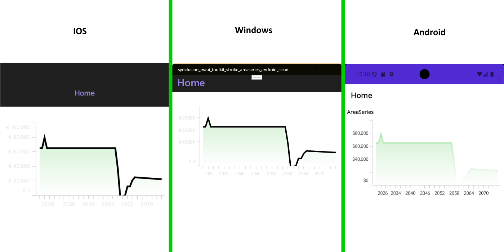

# [SfCartesianChart] AreaSeries Stroke is not rendered on Android

## Description

The `Stroke` (line on top of the area) is not rendered on **Android** when using an
`AreaSeries` in an `SfCartesianChart`. The same chart renders correctly on iOS and
Windows, where the black stroke line is drawn over the gradient fill.

On Android only the gradient fill is drawn — the stroke line is completely missing,
even with a high `StrokeWidth`.

## Reproduction

Minimal repro app included in this repository (`Syncfusion.Maui.Toolkit` 1.0.12, .NET MAUI 11).
`MainPage.xaml` contains a single `AreaSeries` with an explicit `Stroke`:

```xml
<chart:SfCartesianChart.Height>...</chart:SfCartesianChart.Height>
<chart:SfCartesianChart.Series>
    <chart:AreaSeries Label="Income"
        EnableTooltip="True" EnableAnimation="True" StrokeWidth="4"
        ItemsSource="{Binding IncomeData, Mode=OneWay}"
        Opacity="1"
        ShowMarkers="False"
        XBindingPath="Year"
        YBindingPath="Amount"
        LegendIcon="SeriesType"
        Stroke="#FF000000">
        <chart:AreaSeries.Fill>
            <LinearGradientBrush StartPoint="0,0" EndPoint="0,1">
                <GradientStop Color="{StaticResource IncomeGradientStartColor}" Offset="0.0" />
                <GradientStop Color="{StaticResource IncomeGradientEndColor}" Offset="1.0" />
            </LinearGradientBrush>
        </chart:AreaSeries.Fill>
    </chart:AreaSeries>
</chart:SfCartesianChart.Series>
```

## Steps to reproduce

1. Build the repro app for Android (also iOS and Windows for comparison).
2. Observe the `AreaSeries` chart.

## Expected behavior

The `Stroke` line (black, `StrokeWidth="4"`) is drawn on top of the area fill on all platforms, as it is on iOS and Windows.

## Actual behavior

- **iOS / Windows:** the black stroke line is drawn correctly over the gradient fill.
- **Android:** the stroke line is **not** drawn at all — only the gradient fill is visible.



## Environment

- Syncfusion.Maui.Toolkit version: 1.0.12
- .NET MAUI: 11.0.10
- .NET: 11
- Platforms: Android (bug), iOS (OK), Windows (OK)
